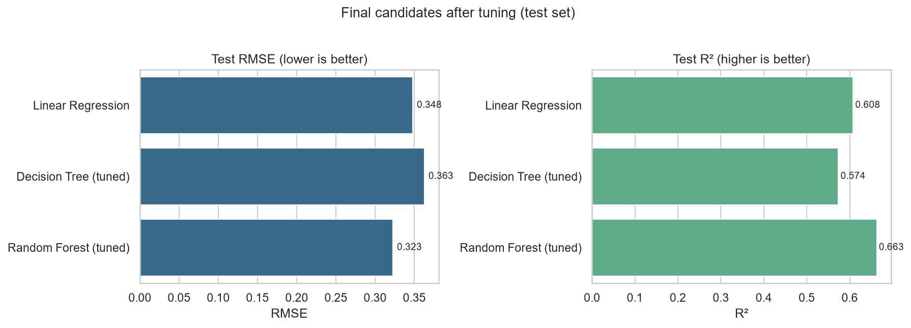
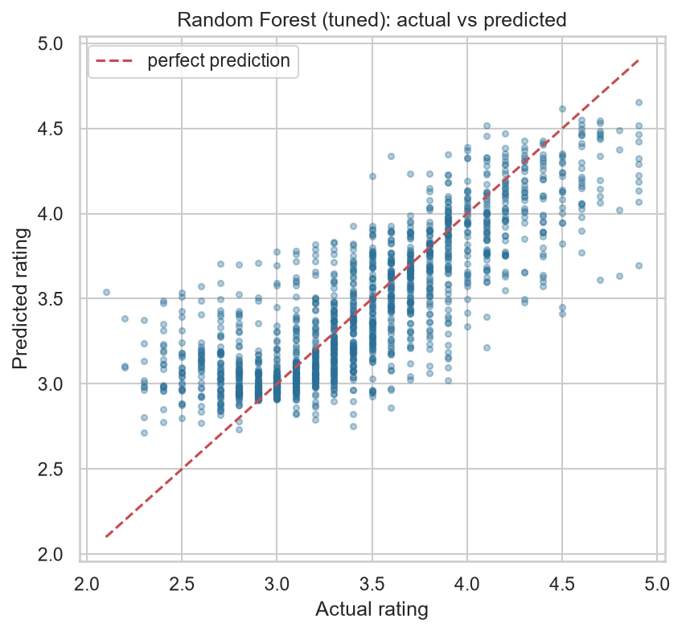
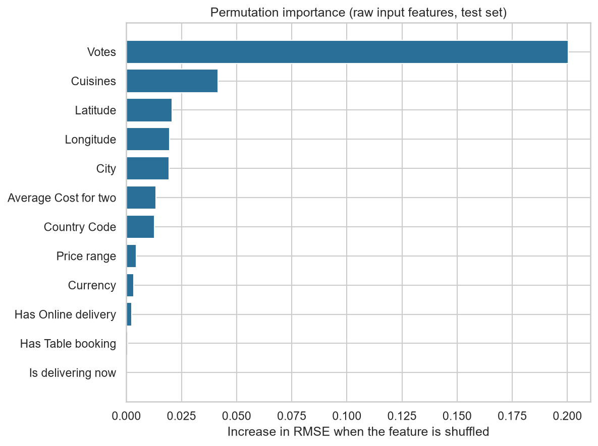

# Task 1: Restaurant Rating Prediction

**Cognifyz Technologies, Machine Learning Internship**

A regression project that predicts a restaurant's **aggregate rating** (0-5) from its other attributes (location, cuisines, price level, services, votes) using the official Cognifyz dataset.

## Objectives
1. Understand and explore the provided restaurant dataset.
2. Clean it, engineer meaningful features and avoid data leakage.
3. Train and compare **Linear Regression, Decision Tree and Random Forest** regressors.
4. Evaluate with **MAE, MSE, RMSE and R²**, tune hyper-parameters and diagnose over/under-fitting.
5. Identify which features drive ratings and demonstrate predictions.

## Dataset
`dataset/Dataset.csv`: the official file, used unmodified. **9,551 restaurants, 21 columns**, from 15 countries (about 90% in India). No duplicates; only `Cuisines` has missing values (9 rows).

### Key data findings that shaped the project
| Finding | Decision |
|---|---|
| `Rating color` and `Rating text` are exact bins of the target (e.g. "Excellent" = 4.5-4.9) | **Dropped: target leakage** |
| 2,148 restaurants (22.5%) have rating 0 = *"Not rated"*, and all have ≤3 votes | Main model trains on the **7,403 rated restaurants**; effect of including them is measured separately |
| `Average Cost for two` is in 12 different currencies | Replaced by a **currency-normalised cost ratio** |
| `Cuisines` is multi-valued ("North Indian, Chinese") | Count + 0/1 flags for the 15 most common cuisines |
| `Votes` spans 0-10,934 (heavy right skew) | `log1p` transform |
| ID, name, address, locality (very high cardinality) and constant `Switch to order menu` | Dropped |

## Methodology
```
raw CSV -> prepare_data (fill Cuisines, drop unrated) -> 80/20 train/test split
        -> Pipeline[ FeatureEngineer -> OneHot(Country, City) + StandardScaler -> model ]
        -> compare models -> tune with 5-fold CV (train only) -> select by CV RMSE
        -> evaluate once on the untouched test set -> importance -> save pipeline
```
* **No data leakage:** the split happens first; every learned quantity (top cuisines, median cost per currency, encoders, scalers) is fitted *inside* the Pipeline on training data only, including within each cross-validation fold.
* **Model selection** uses cross-validated RMSE on the training set, not the test score.

## Technologies
Python 3.12, Pandas, NumPy, Matplotlib, Seaborn, Scikit-learn, Joblib, Jupyter.

## Project structure
```
Task-1-Restaurant-Rating-Prediction/
├── dataset/Dataset.csv                  official data
├── notebooks/restaurant_rating_prediction.ipynb   full walkthrough: EDA -> evaluation
├── src/
│   ├── config.py          paths, constants, dropped-column reasons
│   ├── data_loader.py     load + prepare data
│   ├── features.py        FeatureEngineer transformer
│   ├── modeling.py        pipelines, metrics, comparison, tuning
│   ├── visualize.py       plotting functions
│   ├── train.py           end-to-end training script
│   └── predict.py         demo + interactive prediction
├── models/best_model.joblib, metrics.json
├── outputs/               figures/ and result tables (CSV/JSON)
├── VIVA_QUESTIONS.md      viva / interview preparation
├── requirements.txt
└── README.md
```

## Results
All numbers below come from `src/train.py` (random_state = 42; 5,922 training / 1,481 test rows).

### Untuned models, test set
| Model | MAE | MSE | RMSE | R² | Train R² |
|---|---|---|---|---|---|
| Baseline (predict mean) | 0.455 | 0.309 | 0.556 | 0.000 | 0.000 |
| Linear Regression | 0.261 | 0.121 | 0.348 | 0.608 | 0.582 |
| Decision Tree | 0.348 | 0.228 | 0.478 | 0.263 | 1.000 |
| Random Forest | 0.243 | 0.108 | 0.329 | 0.649 | 0.945 |

The untuned Decision Tree **overfits severely** (train R² = 1.00 vs test 0.26).

### After tuning (selection by 5-fold CV RMSE on train)
| Model | CV RMSE | Test MAE | Test MSE | Test RMSE | Test R² | Train R² |
|---|---|---|---|---|---|---|
| Linear Regression | 0.360 | 0.261 | 0.121 | 0.348 | 0.608 | 0.582 |
| Decision Tree (tuned) | 0.374 | 0.270 | 0.132 | 0.363 | 0.574 | 0.585 |
| **Random Forest (tuned)** | **0.342** | **0.239** | **0.105** | **0.323** | **0.662** | 0.813 |

**Best model: tuned Random Forest**: `n_estimators=300, max_depth=20, min_samples_leaf=3, max_features=0.3`. Its typical error is about **0.24 rating points** (MAE) and it explains about **66% of the variance** in ratings.

Honest reading: tuning the forest gave a modest gain over the untuned one (R² 0.649 → 0.662). The forest still fits training data better than test data (0.81 vs 0.66), which is normal for forests; cross-validation agrees with the test result, so it is not a lucky split. Tuning cured the Decision Tree's overfitting, but the constrained tree is then too simple to beat Linear Regression.




### Robustness experiments (`outputs/ablation_results.csv`)
Each row uses its own split, so compare direction, not absolute values.

| Experiment | Rows | MAE | RMSE | R² |
|---|---|---|---|---|
| Main: rated restaurants, all features | 7,403 | 0.239 | 0.323 | 0.662 |
| Rated restaurants, **without Votes** | 7,403 | 0.294 | 0.376 | 0.543 |
| Including "Not rated" (0) rows | 9,551 | 0.198 | 0.296 | 0.961 |

* Without `Votes` the model still explains ~54% of variance, so cuisine, location and price carry real signal.
* The 0.961 R² when including unrated rows is **not** better modelling: the model just learns "almost no votes → rating 0". That is why they are excluded from the main model.

### Feature importance
Permutation importance on the test set (increase in RMSE when a raw column is shuffled):

| Feature | RMSE increase |
|---|---|
| **Votes** | 0.195 |
| Cuisines | 0.039 |
| City | 0.026 |
| Longitude / Latitude | 0.018 / 0.018 |
| Average Cost for two | 0.012 |
| Country Code | 0.011 |
| Price range | 0.005 |
| Service flags (table booking, online delivery, delivering now) | ≤ 0.002 |



## How to run
```bash
pip install -r requirements.txt

python src/train.py                 # trains, tunes, saves model + all outputs (~5 min on 1 CPU)
python src/predict.py --demo        # predictions on 5 unseen test restaurants
python src/predict.py --interactive # enter your own restaurant's details
jupyter notebook notebooks/restaurant_rating_prediction.ipynb
```
Run commands from the project root. The saved model (`models/best_model.joblib`) is the whole pipeline, so it accepts raw restaurant columns directly.

### Sample prediction (held-out test restaurants)
| City | Cuisines | Votes | Actual | Predicted |
|---|---|---|---|---|
| Noida | North Indian, Chinese | 23 | 2.3 | 2.99 |
| Patna | North Indian, Chinese | 32 | 3.5 | 3.60 |
| New Delhi | Street Food, North Indian | 116 | 3.7 | 3.56 |
| New Delhi | North Indian, Mughlai | 19 | 3.4 | 3.18 |
| Coimbatore | Bakery, Desserts | 200 | 4.9 | 4.08 |

Predictions are good for typical restaurants but under-predict extreme ratings (note the 4.9 case), because forests average towards the mean.

## Limitations and future work
* `Votes` partly reflects popularity that accumulates *with* good ratings. It is available at prediction time here, but it makes the task easier than predicting for a brand-new restaurant (the no-Votes experiment shows that harder case).
* About 90% of data is from India, so performance elsewhere is less certain.
* Unrated restaurants are excluded by design.
* There is no review text; ratings are subjective, so a ceiling well below R² = 1 is expected.
* Next steps: gradient boosting (`HistGradientBoostingRegressor`), per-country evaluation, text features if reviews were available.

## Author
Pavana B M, B.Tech AI & ML, SJC Institute of Technology
